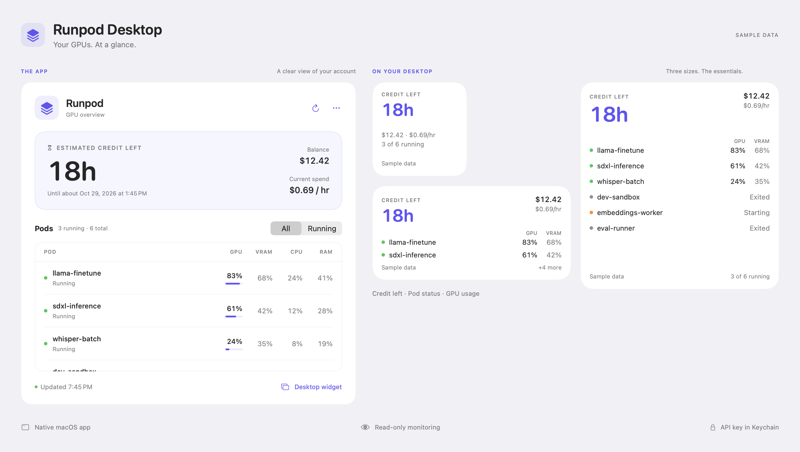

# Runpod Desktop

A native macOS app and desktop widget for keeping an eye on your Runpod GPU pods, account balance, and estimated credit time remaining.

<picture>
  <source media="(prefers-color-scheme: dark)" srcset="RunpodWidgetPreview-dark.png">
  
</picture>

*The app and all three widget sizes, rendered from the actual SwiftUI views with sample data. [Light preview](RunpodWidgetPreview.png) · [Dark preview](RunpodWidgetPreview-dark.png).*

## Features

- Account balance, current hourly spend, and estimated hours of credit remaining.
- Pod status, GPU utilization, and GPU memory utilization, plus CPU and RAM usage in the app.
- Small, medium, and large desktop widgets, with running pods shown first.
- A simple light/dark dashboard with a clear credit estimate, labeled balance and spend, GPU usage bars, and an All/Running pod filter.
- Manual refresh, sample data previews, and timestamps that flag stale or offline readings.
- API key storage in macOS Keychain. The app only reads account and pod information.

| Widget size | What it shows |
| --- | --- |
| Small | Credit estimate, balance, hourly spend, and running-pod count |
| Medium | Account summary and GPU/VRAM metrics for up to two pods |
| Large | Account summary and GPU/VRAM metrics for up to six pods |

## Requirements

- An Apple silicon Mac running macOS 14 Sonoma or later. The build script currently targets `arm64` only.
- Apple's Command Line Tools with a Swift compiler and macOS SDK supporting macOS 14 or later. Install them with `xcode-select --install` if needed.
- A Runpod account and a read-only API key for live readings. Sample data works without an account.

There are no third-party package dependencies, and an Xcode project is not required. The script supplies both the app-extension compiler flag and the macOS XPC extension linker entry point.

## Build and run

```bash
git clone git@github.com:Abteen-Arab/RunPod_GPU_Widget_App_Mac.git
cd RunPod_GPU_Widget_App_Mac
bash RunpodDesktop/build.sh
open ~/Applications/"Runpod Desktop.app"
```

The script compiles the app and its WidgetKit extension, signs them locally, verifies the signatures, quits any running copy, and installs a single `Runpod Desktop.app` into `~/Applications`, registering it with Launch Services. Each build gets a unique `CFBundleVersion`. This is an ad hoc signed personal build; it is not notarized or distributed through the App Store.

The installer unregisters older copies with this exact app ID, including renamed backups, so macOS uses the installed build. Backup files are left intact. Opening another copy later may register it again; use the repair command below if needed.

On the first build, the script generates `RunpodDesktop/Shared/BridgeConfiguration.swift` with a random credential shared by the app and its widget. This file and all compiled app bundles are excluded from Git. Build the app and extension together so they use the same credential.

Build paths can be customized:

| Variable | Default |
| --- | --- |
| `RUNPOD_BUILD_DIR` | `.build` in the repository root |
| `RUNPOD_OUTPUT_DIR` | `~/Applications` |
| `RUNPOD_MODULE_CACHE` | `module-cache` inside the build directory |
| `RUNPOD_BUILD_NUMBER` | Current time as `YYYYMMDDHHMMSS` |

Intermediate files stay inside the ignored `.build` directory, and the staging bundle is removed after installation. The script also handles duplicate SwiftBridging module definitions in some Command Line Tools installations through a local compiler overlay, without changing system files.

## Connect your account

1. Open **Runpod Desktop**.
2. Create a read-only API key with access to your pod and account information in [Runpod Console → Credentials](https://console.runpod.io/user/credentials).
3. Paste the key into the app and click **Connect Runpod**. The key is saved in Keychain.
4. Right-click an empty area of the desktop, choose **Edit Widgets**, search for **Runpod Desktop**, and add your preferred size.

Keep the app running for fresh readings; closing its window is fine. Open it again after restarting your Mac. Use **Try with sample data** to see the interface without connecting an account; sample data only appears in the app window, never on the desktop widget. **Disconnect**, in the **⋯** menu, removes the saved API key from Keychain.

## Upgrading from an earlier build

Rebuild with `bash RunpodDesktop/build.sh`, then open the installed app. The installer updates both the app and widget together, verifies their signatures, and repairs Runpod's registrations.

If an existing Runpod widget stays blank, remove it and add a fresh one from **Edit Widgets → Runpod Desktop**. Older local builds may have left placements using a retired extension ID; those placements cannot be migrated by re-registering the app. Your saved API key remains in Keychain, although macOS may ask you to allow access after the rebuild.

## Updates and estimates

The app polls Runpod every minute while running. The widget requests a new timeline every 15 minutes, but macOS controls when it actually refreshes. Clicking the widget opens the app and requests an update; an immediate widget redraw is not guaranteed.

Readings older than 15 minutes are marked stale. Connection failures preserve the last known values and show an offline indicator.

Estimated credit time is **account balance ÷ current account hourly spend**, rounded down and shown as minutes, hours and minutes under two days, or days and hours. It assumes spending stays constant; workload changes, storage, and other charges can change the result. Estimates under six hours are highlighted. Zero reported spend displays **No spend**. Missing values display a dash. GPU percentages average the available readings across a pod's GPUs. Pod status reflects Runpod's reported state and does not check the health of a service running inside the pod.

## Privacy and architecture

The app queries `https://api.runpod.io/graphql` over HTTPS using a bearer token. It does not start, stop, or delete pods. Your API key is stored in the app's macOS Keychain item and is never sent to the widget.

The widget receives monitoring snapshots through an authenticated local connection at `127.0.0.1:47361`. It caches the last snapshot in its own preferences so readings remain visible when the app is unavailable. These snapshots include account balances and pod metrics, but not the API key.

## Run the offline checks

From the repository root:

```bash
bash RunpodDesktop/check.sh
```

The checks cover response parsing, missing and invalid metrics, GPU averaging, status freshness, credit calculations, HTTP/network errors, and request construction. They also exercise the actual widget provider and local bridge: authenticated reads, rejected credentials, startup loading, a failed first request, cache preservation, disconnect clearing, demo rejection, and offline fallback. Tests use a separate temporary app, preferences domain, port, and credential; they never read your Runpod API key or the app's bridge credential.

To regenerate sample-only light/dark app and widget previews:

```bash
bash RunpodDesktop/render-previews.sh
```

Images are written to `.build/previews`. To update the README's light and dark figures after reviewing them:

```bash
cp .build/previews/RunpodWidgetPreview.png RunpodWidgetPreview.png
cp .build/previews/RunpodWidgetPreview-dark.png RunpodWidgetPreview-dark.png
```

The preview renderer does not start the app model, read Keychain, contact Runpod, or use live account data.

## Troubleshooting

**The widget is missing or blank.** Open the installed app, then check its **Desktop widget** sheet. To inspect its bundle, signature, and macOS registrations:

```bash
python3 RunpodDesktop/widget-doctor.py
```

To re-register the installed app and extension and restart your widget host:

```bash
python3 RunpodDesktop/widget-doctor.py --repair --restart-host
```

The repair only changes Runpod registrations and restarts the current user's `chronod`; it leaves app copies, widget placements, other widgets, preferences, and credentials intact. Open Runpod Desktop again afterward.

**An older blank widget remains.** Remove that Runpod widget and add it again from **Edit Widgets → Runpod Desktop**. Some earlier local builds used the extension ID `local.abteen.RunpodDesktop.MonitorWidget`; existing placements using that retired ID cannot load the current `.Widget` extension. Re-registering the app does not migrate those placements.

**The widget extension exits immediately.** Rebuild with the current script. Previous builds wrapped a normal Swift executable in an `.appex`; the widget now links with the `_NSExtensionMain` entry point specified by Apple's app-extension build settings. That provides the XPC service lifecycle needed for macOS to query its descriptors. The failure matches this [upstream WidgetKit runtime investigation](https://github.com/steipete/CodexBar/issues/1095).

**The app asks for Keychain access after every rebuild.** Ad hoc signatures change with each build, so macOS asks before a new build can read the saved key. Choose **Always Allow**.

## Source layout

```text
RunpodDesktop/
├── App/                 SwiftUI dashboard, account setup, Keychain access, and polling
├── Widget/              WidgetKit timeline provider and desktop widget
├── Shared/              API client, data models, local bridge, and shared views
├── Resources/           App icon, bundle metadata, and widget entitlements
├── Tests/               Offline core and widget/bridge regression checks
├── Tools/               Sample-only preview renderer
├── build.sh             Build, local signing, installation, and registration
├── check.sh             Run isolated regression checks
├── render-previews.sh   Render the app and widget figures
└── widget-doctor.py      Inspect or repair Runpod's macOS registrations
```

Build and signature validation, offline regression checks, and actual widget descriptor, snapshot, and timeline loading were verified on macOS 26.6.2 with Swift 6.4. The minimum deployment target is macOS 14; older supported macOS releases have not been manually tested in this review.
